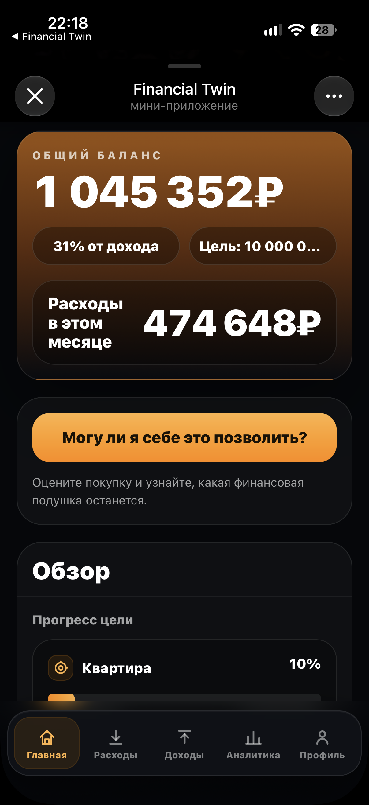
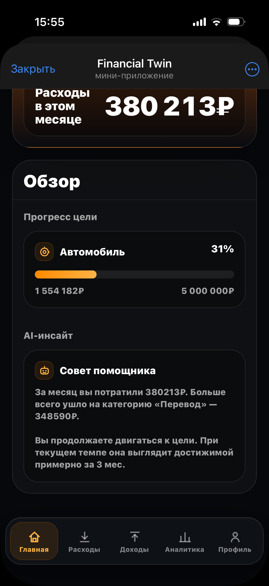
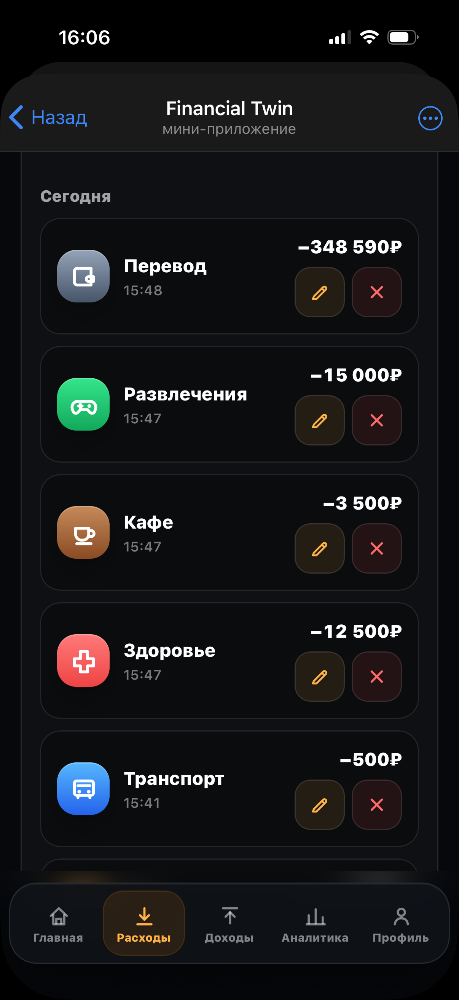
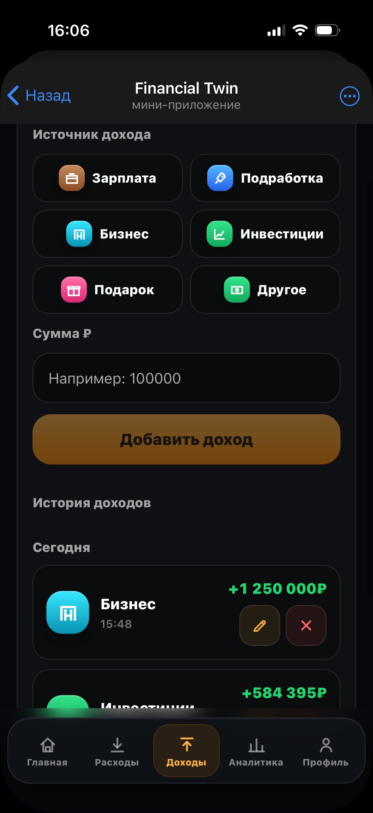
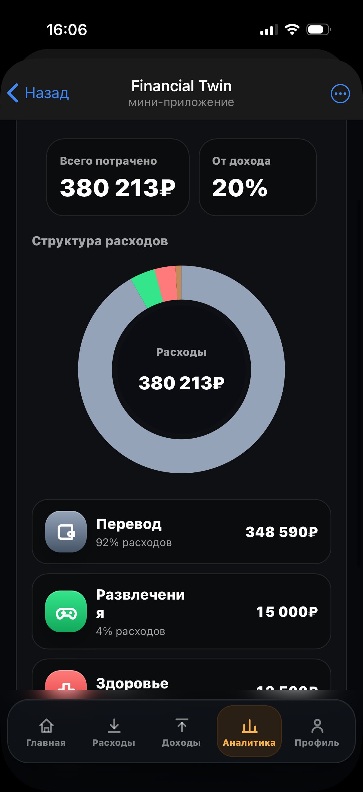
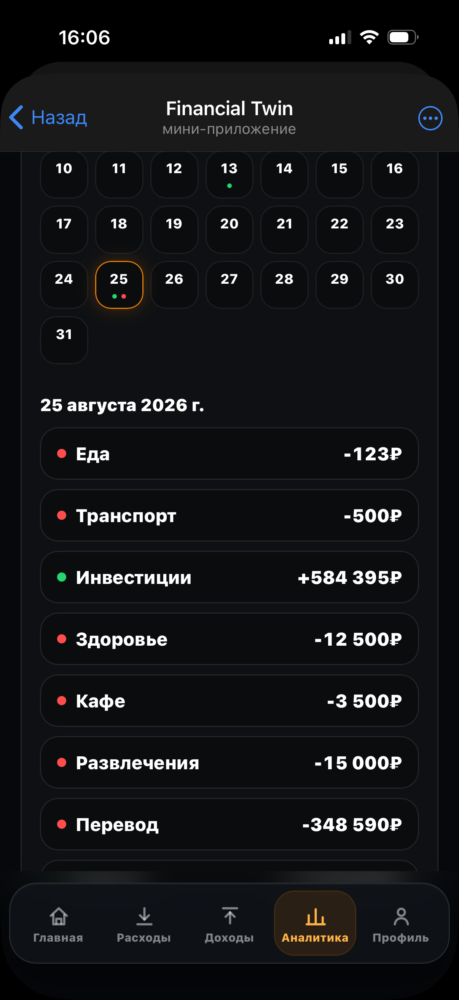
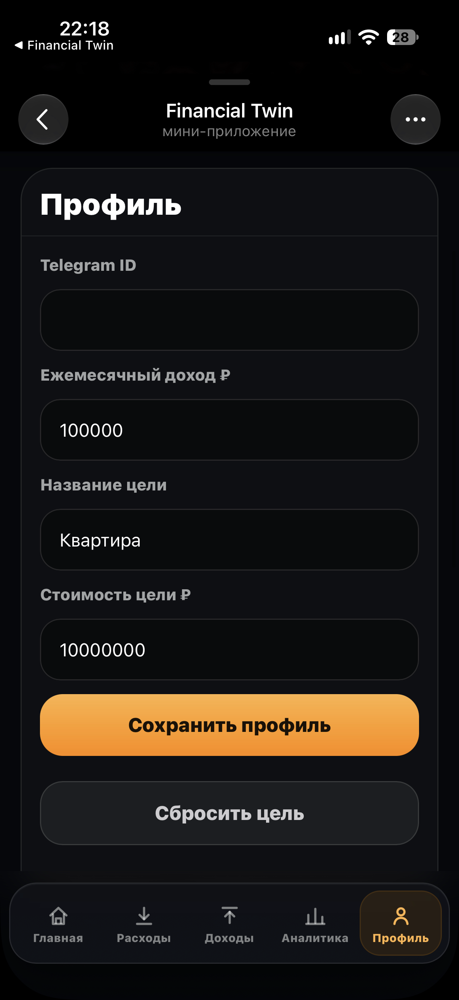
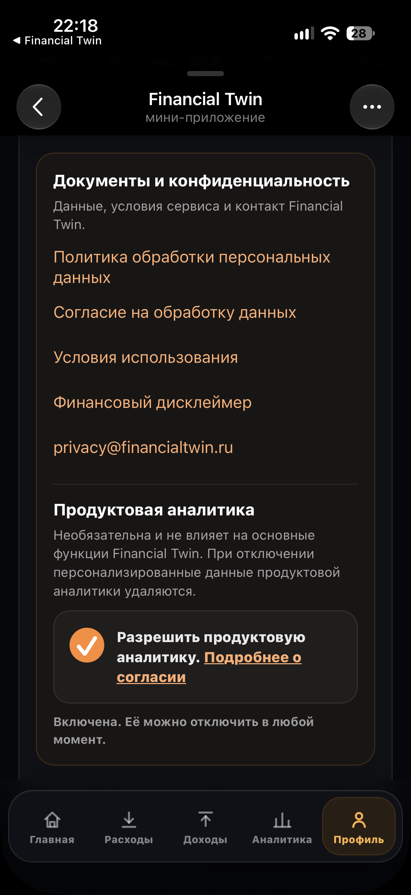
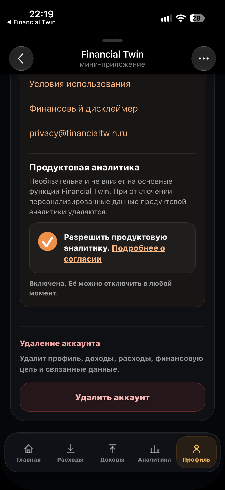

<div align="center">

<h1>Financial Twin</h1>

<p>
  <strong>Personal finance assistant built as a Telegram Mini App.</strong>
</p>

<p>
  Track income, expenses, balance, financial goals and analytics directly inside Telegram.
</p>

<p>
  <strong>MVP v0.1.0</strong> · Feature Frozen · Preservation in Progress · Russian-speaking audience
</p>

<p>
  <code>Python</code>
  <code>FastAPI</code>
  <code>PostgreSQL</code>
  <code>SQLAlchemy</code>
  <code>JavaScript</code>
  <code>Nginx</code>
</p>

<p>
  <a href="README.md"><strong>English</strong></a>
  ·
  <a href="README.ru.md">Русский</a>
</p>

<br>



</div>

<br>

> **Interface language:** Russian  
> Financial Twin was designed primarily for a Russian-speaking audience.

> This repository is a public showcase of the project. Production source code, credentials, infrastructure secrets and user data are intentionally not included.

---

## Project Status

**MVP v0.1.0 · Feature Frozen · Preservation in Progress**

Financial Twin reached a working production MVP and closed-beta stage.

The project went through the full product lifecycle: product design, implementation, production deployment, security hardening, privacy and consent flows, analytics, internal QA, user testing and initial product validation.

Active feature development and user acquisition are currently paused.

After completing the MVP, production deployment, internal QA and initial user validation, a feature freeze was introduced while the product direction and further development priorities are being reassessed.

The production service is scheduled to be taken offline on **November 19, 2026** as part of a controlled preservation process and infrastructure cost reduction.

The project is being retained in a recoverable state, including:

- Source code and complete Git history
- Database schemas and migrations
- Production architecture and deployment documentation
- Backup and recovery artifacts
- Security and privacy implementation
- Analytics infrastructure
- Operational and restoration procedures

The public repository will remain available as a **product and engineering showcase** after the production service is taken offline.

Financial Twin may be resumed, redesigned or developed further in the future based on new product hypotheses, available resources and additional validation.

---

## Product Overview

Financial Twin was developed as a complete digital product — from product logic and UI/UX to backend architecture, database design, security, analytics, deployment and production infrastructure.

The product was built around a simple personal finance workflow inside Telegram:

- Record income
- Record expenses
- Monitor current balance
- Track a financial goal
- Review monthly analytics
- Explore transaction history
- Use a financial calendar
- Receive financial insights
- Evaluate planned purchases
- Manage account and privacy settings

The goal was to make personal finance tracking and basic financial decision support accessible directly inside Telegram without requiring users to install a separate native application.

---

## Core Features

### Personal Finance

- Income management
- Expense management
- Category-based transaction tracking
- Automatic balance calculation
- Financial goals and progress tracking
- Monthly analytics
- Transaction history
- Calendar-based finance overview
- Personalized financial insights

### Financial Decision Support

Financial Twin also includes the **“Can I afford it?”** scenario.

The feature is designed to help users evaluate a planned purchase and understand how that purchase may affect their remaining financial cushion.

This represents a shift from simple transaction tracking toward helping users make everyday financial decisions.

### Telegram Integration

- Telegram Mini App interface
- Telegram `initData` authentication validation
- Server-side Telegram identity verification
- Protected API requests
- User-specific data access
- Telegram-aware navigation
- Telegram start parameter support for acquisition attribution

### Onboarding

- Server-side onboarding state
- Initial income setup
- Optional financial goal setup
- Resume support for incomplete onboarding
- Compatibility with existing users
- Validation and error handling

### Account & Privacy

- Account management
- Personal data isolation
- Privacy consent flow
- Consent and policy version tracking
- Self-service account deletion
- Deletion workflow state tracking
- Separate deletion audit ledger
- Account incarnation tracking

---

## Analytics & Product Instrumentation

Financial Twin includes an internal analytics system designed to support product validation and user behavior analysis.

Implemented capabilities include:

- Analytics sessions
- Product events
- Acquisition source tracking
- Telegram `start_param` attribution
- User journey instrumentation
- Activation analysis
- Retention analysis support
- Analytics data retention rules

Analytics were introduced to support real product experiments rather than only technical monitoring.

---

## Architecture

```text
Telegram
   │
   ▼
Telegram Mini App
   │
   ▼
HTML / CSS / JavaScript
   │
   │ REST API
   ▼
FastAPI
   │
   ├── Authentication
   ├── Business Logic
   ├── Validation
   ├── Analytics
   ├── Privacy / Consent
   └── User Isolation
   │
   ▼
SQLAlchemy
   │
   ▼
PostgreSQL
```

### Production Infrastructure

```text
Client
   │
   │ HTTPS
   ▼
Nginx
   │
   ▼
FastAPI / Uvicorn
   │
   ▼
PostgreSQL
```

The production environment was deployed on a Linux VPS and operated through a reverse-proxy and application-service architecture.

---

## Tech Stack

### Backend

- Python
- FastAPI
- SQLAlchemy
- Pydantic
- PostgreSQL
- Alembic

### Frontend

- HTML
- CSS
- JavaScript
- Telegram Mini Apps API

### Infrastructure

- Ubuntu Linux
- Nginx
- Uvicorn
- systemd
- VPS
- HTTPS
- Let's Encrypt
- Git
- GitHub

---

## Security

Security was treated as part of the product architecture rather than an afterthought.

Implemented practices include:

- Telegram authentication validation
- Server-side identity verification
- Protected API endpoints
- User data isolation
- Resource ownership checks
- Input validation
- Environment-based secret management
- Credentials stored outside source code
- HTTPS
- Privacy controls
- Account deletion flow
- Versioned consent handling
- Separate append-only deletion audit ledger

Sensitive production information is intentionally excluded from this public repository.

---

## Privacy & Data Lifecycle

Financial Twin includes dedicated privacy, consent and account deletion mechanisms.

The implementation covers:

- Explicit privacy consent
- Privacy policy version tracking
- Consent version tracking
- Terms version tracking
- Product analytics consent
- Account deletion requests
- Deletion state management
- Account incarnation identifiers
- Separation of operational data and deletion audit records
- Retention rules for analytics data

The deletion ledger was designed separately from the main application data so that deletion events could remain auditable without retaining deleted operational finance data.

---

## Engineering Highlights

Financial Twin includes significantly more than the visible finance interface.

The project also covers:

- Database migrations and schema evolution
- Backend validation and error handling
- Loading, empty, error, success and disabled UI states
- Network error handling
- Telegram-specific authentication and navigation
- Mobile keyboard handling
- Safe-area support
- Long amount and long text handling
- Responsive mobile layouts
- Secure secret management
- User ownership validation
- Product analytics instrumentation
- Privacy and deletion workflows
- Infrastructure configuration
- Backup and recovery preparation
- Production deployment workflow
- Internal QA before closed beta

The MVP completed a full internal QA cycle before closed-beta use.

---

## Product Preview

Financial Twin was designed as a mobile-first Telegram Mini App with a dark interface and a consistent visual system across the main personal finance flows.

### Dashboard

<p align="center">
  
  
</p>

The dashboard provides a quick overview of the user's current balance, monthly spending, financial goal progress and personalized financial insight.

It also includes the **“Can I afford it?”** scenario — a decision-support feature designed to help users evaluate a planned purchase and understand how it may affect their remaining financial cushion.

### Everyday Finance

<p align="center">
  
  
  
</p>

Users can manage expenses and income by category, review transaction history and analyze the structure of their spending.

### Financial Calendar & Profile

<p align="center">
  
  
</p>

The financial calendar connects transactions to specific dates, while the profile section allows users to configure monthly income, manage their financial goal and update account settings.

### Privacy & Data Controls

<p align="center">
  
  
</p>

Financial Twin includes dedicated privacy and data-management controls directly inside the application.

Users can access:

- Personal data processing documentation
- Data processing consent
- Terms of use
- Financial disclaimer
- Product analytics consent
- Account deletion controls

Product analytics are optional and can be disabled by the user.

The account deletion flow allows users to remove their profile, finance records, financial goal and associated operational data.

---

## Product Lifecycle

Financial Twin progressed through multiple product and engineering stages:

```text
Idea
  ↓
Product Concept
  ↓
Prototype
  ↓
MVP Development
  ↓
Production Deployment
  ↓
Security Hardening
  ↓
Privacy & Account Deletion
  ↓
Internal QA
  ↓
Closed Beta
  ↓
Analytics & Product Instrumentation
  ↓
User Acquisition Experiments
  ↓
Product Validation
  ↓
Feature Freeze
  ↓
Preservation
```

The project was not stopped at the prototype stage.

It reached production, was used in real-world testing and generated product feedback that informed the decision to pause further development.

---

## Product Validation

After the MVP was completed, Financial Twin moved into early user validation.

The project included:

- Closed-beta testing
- Real-user feedback
- User acquisition experiments
- Activation measurement
- Retention observation
- Product analytics
- Evaluation of product-market fit hypotheses

The validation phase showed that further product work should focus not simply on adding more features, but on strengthening the core recurring value and the reason for users to return regularly.

Rather than continuing feature development without sufficient validation, the project was placed into a feature freeze.

---

## Preservation & Recovery

Financial Twin is being preserved so that development can potentially be resumed in the future without rebuilding the project from scratch.

The preservation process includes:

- Source code archive
- Complete Git history
- Database schema backups
- Alembic migration state
- Production backup artifacts
- External audit-ledger schema
- Deployment documentation
- Infrastructure recovery information
- Restore verification

The purpose of preservation is to reduce recurring infrastructure costs while retaining the technical and product work completed during development.

---

## Public Showcase Policy

The main Financial Twin development repository is private.

This public repository exists to demonstrate:

- Product concept
- Product functionality
- System architecture
- Technology stack
- Engineering approach
- Security approach
- Product analytics
- UI/UX
- Development scope
- Product lifecycle

It intentionally does **not** contain:

- Production credentials
- `.env` files
- Database passwords
- Telegram tokens
- Private infrastructure configuration
- Database dumps
- User data
- Production logs
- Internal production source code
- Sensitive operational information

---

## What This Project Demonstrates

Financial Twin demonstrates experience across both product development and engineering:

- Turning a product idea into a working MVP
- Designing a Telegram Mini App
- Building a REST backend
- Designing and evolving a PostgreSQL database
- Implementing authentication and user isolation
- Managing database migrations
- Building privacy and deletion workflows
- Instrumenting product analytics
- Deploying and operating a production application
- Designing backup and recovery procedures
- Running real-user product validation
- Analyzing activation and retention
- Making product decisions based on real feedback
- Preserving a production project in a recoverable state

---

## Author

**Tamerlan Ismailov**

Business Informatics student interested in business analysis, product development, backend systems and building digital products.

[GitHub Profile](https://github.com/tamerlanismailov)
