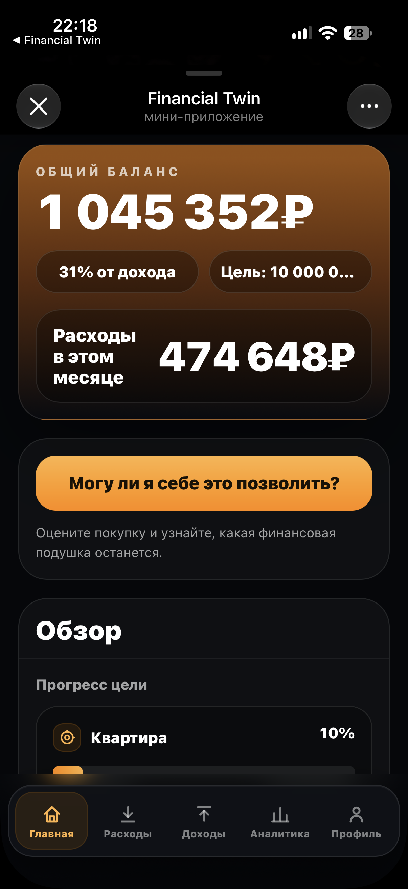
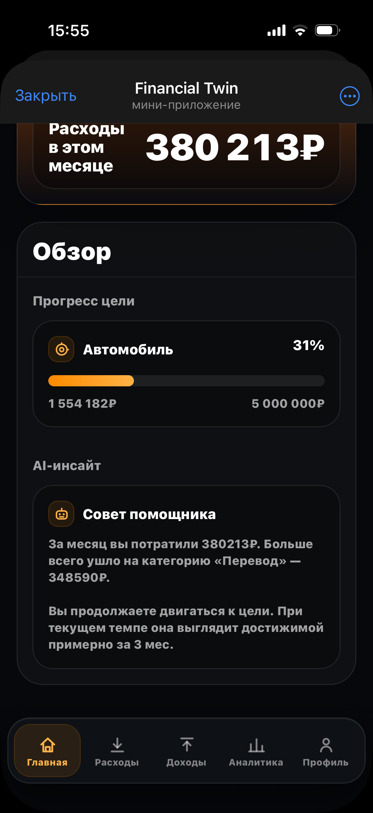
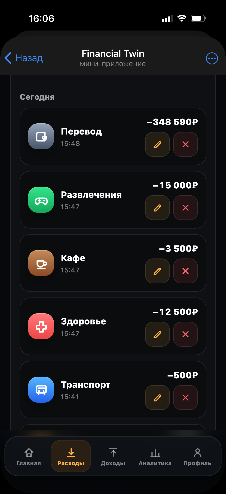
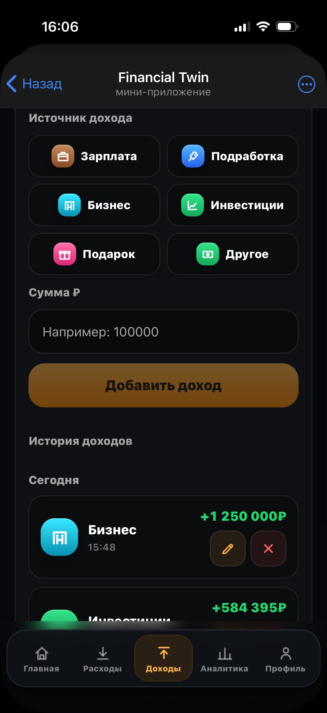
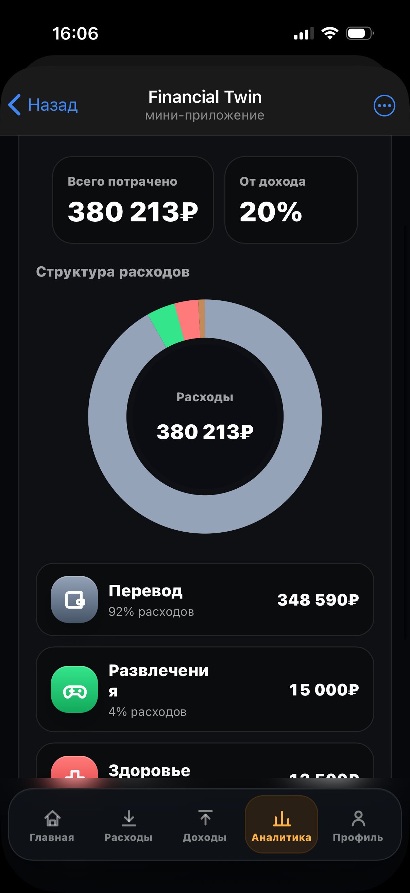
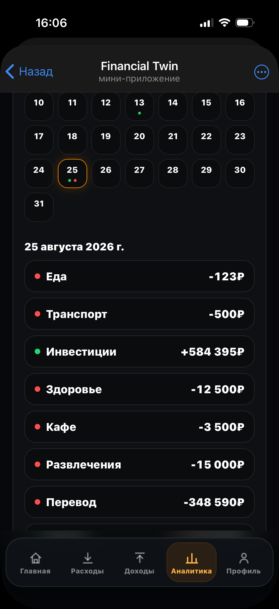
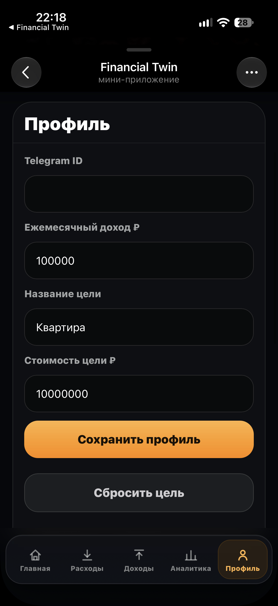

<div align="center">

<h1>Financial Twin</h1>

<p>
  <strong>Помощник по управлению личными финансами в формате Telegram Mini App.</strong>
</p>

<p>
  Учёт доходов и расходов, баланс, финансовые цели и аналитика прямо внутри Telegram.
</p>

<p>
  <strong>MVP v0.1.0</strong> · Feature Freeze · Консервация проекта · Русскоязычная аудитория
</p>

<p>
  <code>Python</code>
  <code>FastAPI</code>
  <code>PostgreSQL</code>
  <code>SQLAlchemy</code>
  <code>JavaScript</code>
  <code>Nginx</code>
</p>

<p>
  <a href="README.md">English</a>
  ·
  <a href="README.ru.md"><strong>Русский</strong></a>
</p>

<br>



</div>

<br>

> **Язык интерфейса:** русский  
> Financial Twin создавался в первую очередь для русскоязычной аудитории.

> Этот репозиторий является публичной витриной проекта. Production-код, учётные данные, инфраструктурные секреты и пользовательские данные намеренно не публикуются.

---

## Статус проекта

**MVP v0.1.0 · Feature Frozen · Консервация**

Financial Twin дошёл до стадии работающего production MVP и закрытого бета-тестирования.

Проект прошёл полный цикл продуктовой и технической разработки: проектирование продукта, реализацию, развёртывание в production, усиление безопасности, privacy- и consent-механизмы, продуктовую аналитику, внутренний QA, пользовательское тестирование и первичную проверку продуктовых гипотез.

Активная разработка новых функций и привлечение пользователей в настоящий момент приостановлены. После завершения MVP и первых пользовательских тестов был введён feature freeze для переоценки дальнейшего продуктового направления и приоритетов развития.

Production-сервис планируется отключить **19 ноября 2026 года** в рамках контролируемой консервации проекта и сокращения инфраструктурных расходов.

Проект сохраняется в состоянии, позволяющем потенциально восстановить разработку в будущем. Сохраняются:

- Исходный код и полная Git-история
- Схемы базы данных и миграции
- Документация production-архитектуры и развёртывания
- Резервные копии и материалы для восстановления
- Реализация безопасности и privacy-механизмов
- Инфраструктура продуктовой аналитики
- Операционные инструкции и процедуры восстановления

Публичный репозиторий останется доступным как **продуктовая и инженерная витрина проекта** после отключения production-сервиса.

В будущем Financial Twin может быть возобновлён, переработан или продолжен на основе новых продуктовых гипотез, доступных ресурсов и дополнительной валидации.

---

## О продукте

Financial Twin разрабатывался как полноценный цифровой продукт — от продуктовой логики и UI/UX до backend-архитектуры, проектирования базы данных, безопасности, аналитики, развёртывания и production-инфраструктуры.

Продукт построен вокруг простого сценария управления личными финансами внутри Telegram:

- Добавление доходов
- Добавление расходов
- Контроль текущего баланса
- Отслеживание финансовой цели
- Просмотр ежемесячной аналитики
- История операций
- Финансовый календарь
- Финансовые инсайты
- Управление аккаунтом и настройками конфиденциальности

Цель проекта — сделать базовый контроль личных финансов доступным непосредственно внутри Telegram без необходимости устанавливать отдельное мобильное приложение.

---

## Основные возможности

### Личные финансы

- Управление доходами
- Управление расходами
- Учёт операций по категориям
- Автоматический расчёт баланса
- Финансовые цели и отслеживание прогресса
- Ежемесячная аналитика
- История операций
- Финансовый календарь
- Персонализированные финансовые инсайты

### Интеграция с Telegram

- Интерфейс Telegram Mini App
- Проверка Telegram `initData`
- Серверная проверка личности пользователя Telegram
- Защищённые API-запросы
- Изоляция пользовательских данных
- Навигация с учётом Telegram Mini App
- Поддержка Telegram start parameters для определения источника привлечения

### Onboarding

- Серверное состояние onboarding
- Первоначальная настройка дохода
- Опциональная настройка финансовой цели
- Продолжение незавершённого onboarding
- Совместимость с существующими пользователями
- Валидация и обработка ошибок

### Аккаунт и конфиденциальность

- Управление аккаунтом
- Изоляция персональных данных пользователей
- Privacy consent flow
- Версионирование согласий и документов
- Самостоятельное удаление аккаунта
- Отслеживание состояния процесса удаления
- Отдельный журнал событий удаления
- Отслеживание incarnation аккаунта

---

## Аналитика продукта

В Financial Twin реализована собственная облегчённая система продуктовой аналитики для проверки продуктовых гипотез и анализа поведения пользователей.

Реализованы:

- Аналитические сессии
- Продуктовые события
- Отслеживание источника привлечения
- Атрибуция через Telegram `start_param`
- Инструментирование пользовательского пути
- Анализ активации
- Поддержка анализа retention
- Настраиваемый срок хранения аналитических данных

Аналитика создавалась прежде всего для реальных продуктовых экспериментов, а не только для технического мониторинга.

---

## Архитектура

```text
Telegram
   │
   ▼
Telegram Mini App
   │
   ▼
HTML / CSS / JavaScript
   │
   │ REST API
   ▼
FastAPI
   │
   ├── Authentication
   ├── Business Logic
   ├── Validation
   ├── Analytics
   ├── Privacy / Consent
   └── User Isolation
   │
   ▼
SQLAlchemy
   │
   ▼
PostgreSQL
```

### Production-инфраструктура

```text
Client
   │
   │ HTTPS
   ▼
Nginx
   │
   ▼
FastAPI / Uvicorn
   │
   ▼
PostgreSQL
```

Production-среда была развёрнута на Linux VPS с использованием reverse proxy и отдельного application service.

---

## Технологический стек

### Backend

- Python
- FastAPI
- SQLAlchemy
- Pydantic
- PostgreSQL
- Alembic

### Frontend

- HTML
- CSS
- JavaScript
- Telegram Mini Apps API

### Infrastructure

- Ubuntu Linux
- Nginx
- Uvicorn
- systemd
- VPS
- HTTPS
- Let's Encrypt
- Git
- GitHub

---

## Безопасность

Безопасность рассматривалась как часть архитектуры продукта, а не как дополнительный этап после разработки.

Реализованы:

- Проверка Telegram-аутентификации
- Серверная проверка идентичности пользователя
- Защищённые API-endpoints
- Изоляция пользовательских данных
- Проверка принадлежности ресурсов пользователю
- Валидация входных данных
- Управление секретами через environment
- Хранение credentials вне исходного кода
- HTTPS
- Privacy controls
- Процесс удаления аккаунта
- Версионирование пользовательских согласий
- Отдельный append-only журнал событий удаления

Чувствительная production-информация намеренно отсутствует в этом публичном репозитории.

---

## Конфиденциальность и жизненный цикл данных

Financial Twin включает отдельный механизм управления privacy и удалением аккаунта.

Реализованы:

- Явное согласие пользователя
- Отслеживание версии политики конфиденциальности
- Версионирование согласий
- Версионирование пользовательских условий
- Запрос на удаление аккаунта
- Управление состоянием удаления
- Идентификатор incarnation аккаунта
- Разделение рабочих данных и журнала удаления
- Правила хранения аналитических данных

Журнал удаления был отделён от основной базы приложения, чтобы события удаления могли оставаться аудируемыми без сохранения удалённых финансовых данных пользователя.

---

## Инженерные особенности

Financial Twin включает значительно больше, чем видимую часть интерфейса личных финансов.

В проекте также реализованы:

- Миграции базы данных и развитие схемы
- Backend-валидация и обработка ошибок
- Loading-, empty-, error-, success- и disabled-состояния интерфейса
- Обработка сетевых ошибок
- Telegram-специфичная авторизация и навигация
- Работа с мобильной клавиатурой
- Поддержка safe area
- Обработка длинных сумм и текстов
- Адаптивные мобильные интерфейсы
- Безопасное управление секретами
- Проверка принадлежности данных пользователю
- Продуктовая аналитика
- Privacy- и deletion-механизмы
- Конфигурация инфраструктуры
- Резервное копирование
- Процедуры восстановления
- Production deployment workflow
- Внутренний QA перед закрытой beta

Перед закрытым бета-тестированием MVP прошёл полный внутренний QA.

---

## Превью продукта

Financial Twin создавался как mobile-first Telegram Mini App с тёмным интерфейсом и единой визуальной системой для основных сценариев работы с личными финансами.

### Главный экран

<p align="center">
  
  
</p>

Главный экран показывает текущий баланс пользователя, расходы за месяц, прогресс финансовой цели и персонализированный финансовый инсайт.

### Ежедневное управление финансами

<p align="center">
  
  
  
</p>

Пользователь может управлять доходами и расходами по категориям, просматривать историю операций и анализировать структуру своих расходов.

### Аналитика и аккаунт

<p align="center">
  
  
</p>

Финансовый календарь связывает операции с конкретными датами, а раздел профиля позволяет управлять финансовой целью, настройками конфиденциальности и аккаунтом.

---

## Жизненный цикл проекта

Financial Twin прошёл несколько продуктовых и инженерных этапов:

```text
Идея
  ↓
Концепция продукта
  ↓
Прототип
  ↓
Разработка MVP
  ↓
Production deployment
  ↓
Security hardening
  ↓
Privacy и удаление аккаунта
  ↓
Внутренний QA
  ↓
Закрытая beta
  ↓
Продуктовая аналитика
  ↓
Эксперименты по привлечению пользователей
  ↓
Проверка продуктовых гипотез
  ↓
Feature Freeze
  ↓
Консервация
```

Проект не остановился на стадии прототипа. Он дошёл до production, использовался в реальном пользовательском тестировании и получил обратную связь, которая повлияла на решение приостановить дальнейшую разработку.

---

## Проверка продуктовых гипотез

После завершения MVP Financial Twin перешёл к ранней пользовательской валидации.

В рамках проекта проводились:

- Закрытое бета-тестирование
- Сбор обратной связи от реальных пользователей
- Эксперименты по привлечению пользователей
- Измерение активации
- Наблюдение за retention
- Продуктовая аналитика
- Проверка гипотез product-market fit

Результаты ранней валидации показали, что дальнейшая работа над продуктом должна быть сосредоточена не просто на увеличении количества функций, а на усилении основной повторяемой ценности и причины регулярно возвращаться в приложение.

Поэтому вместо продолжения разработки новых функций без достаточной валидации проект был переведён в режим feature freeze.

---

## Консервация и восстановление

Financial Twin сохраняется таким образом, чтобы в будущем разработку можно было потенциально продолжить без создания проекта заново.

Консервация включает:

- Архив исходного кода
- Полную Git-историю
- Резервные копии схем базы данных
- Состояние Alembic migrations
- Production backup artifacts
- Схему внешнего audit ledger
- Документацию deployment
- Информацию для восстановления инфраструктуры
- Проверку возможности восстановления

Цель консервации — сократить регулярные инфраструктурные расходы, сохранив при этом техническую и продуктовую работу, выполненную за время разработки проекта.

---

## Политика публичного репозитория

Основной репозиторий разработки Financial Twin является приватным.

Этот публичный репозиторий предназначен для демонстрации:

- Концепции продукта
- Функциональности
- Архитектуры системы
- Технологического стека
- Инженерного подхода
- Подхода к безопасности
- Продуктовой аналитики
- UI/UX
- Масштаба разработки
- Жизненного цикла проекта

В репозитории намеренно отсутствуют:

- Production credentials
- `.env` файлы
- Пароли баз данных
- Telegram tokens
- Приватная конфигурация инфраструктуры
- Дампы баз данных
- Пользовательские данные
- Production logs
- Внутренний production-код
- Чувствительная операционная информация

---

## Что демонстрирует этот проект

Financial Twin демонстрирует опыт как в продуктовой разработке, так и в инженерной части:

- Превращение продуктовой идеи в работающий MVP
- Проектирование Telegram Mini App
- Создание REST backend
- Проектирование и развитие PostgreSQL-базы
- Реализация аутентификации и изоляции пользователей
- Управление миграциями базы данных
- Реализация privacy- и deletion-процессов
- Инструментирование продуктовой аналитики
- Развёртывание и эксплуатация production-приложения
- Проектирование резервного копирования и восстановления
- Проведение пользовательских экспериментов
- Принятие продуктовых решений на основе реальной обратной связи
- Консервация production-проекта с возможностью восстановления

---

## Автор

**Tamerlan Ismailov**

Студент направления «Бизнес-информатика», интересующийся бизнес-анализом, продуктовой разработкой, backend-системами и созданием цифровых продуктов.

[GitHub Profile](https://github.com/tamerlanismailov)
